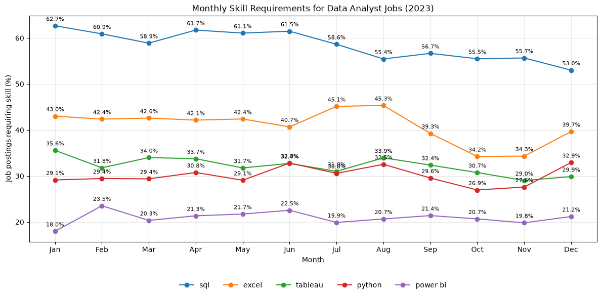

# The Analysis
### 1. What are the most demanded skills for the top 3 most popular data roles?

Skills Demand Analysis

The analysis focuses on the three most popular roles: Data Analyst, Data Scientist, and Data Engineer, with the geographic scope restricted to the United States.

The top five skills for each role were identified by counting skill mentions after exploding the 'job_skills' column. Skill demand was calculated as the percentage of total job postings for each role that mentioned a particular skill.

#### Key Findings:

/Final Project/images/Skills_Demand_Picture.png>)

SQL and Python are among the most in-demand skills across all three roles, particularly for Data Scientists and Data Engineers.

Data Analyst roles show stronger demand for SQL, Excel, and Tableau, reflecting their emphasis on data analysis, reporting, and business intelligence.

The findings, for the top 5 skills for each of the three most popular roles were shown as below.

It was observed that sql and python were the most prominent and common skills which were part of Data Scientist and Engineer roles since they are more inclined towards the technicalities of Data

But Data Analyst Roles required sql, excel and tableau more often since it revolves more around the business aspect and hence requires less technical skills around the data domain.

The detailed analysis using Python can be found in the link 

[2_Skills_Count.ipynb](Project%201%20(Luke%20Barousse)/Final%20Project/2_Skills_Count.ipynb)

### 2. How are in-demand skills trending for Data Analysts?

The geography was again limited to the United States, where the top 5 most in-demand skills based on the number of times they were mentioned in a job posting were
 - sql
 - excel
 - tableau
 - python
 - power bi

The following things were observed:

- sql remained the most dominant skill, through gradually dipping in terms of requirement towards the later months of 2023, still remained highly dominant and relevant
- excel was the second most required skill but showed unsteadyness in terms of its trend
- tableau and python were jointly popular with python requirement showing a dip before the last quarter and then surging in the last quarter 
    - both of them maintained a stable pattern in terms of requirement as a skill
- power bi was the least popular among the top 5, still maintained steady requirement

#### Takeaway

- sql, excel and python maintains their relevance despite some gradual dips in some of their trends but remain the most popular skills to have handy for Data Analyst roles
- The rest of the skills are also good to know even thoough they are not as highly demanded as SQL and excel
- All 5 skills show relatively stable trend standing in 2023, and will be handy for Data Analyst Roles

The steps followed for the conclusion are documented in the following link:

[3_Skills_Trend.ipynb](<Final Project/3_Skills_Trend.ipynb>)
